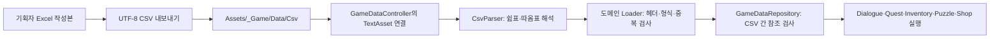
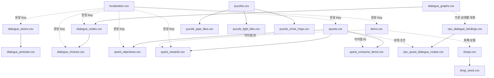

# CSV 시스템 전체 구조

[README로 돌아가기](../README.md)

## CSV가 무엇인가

CSV는 표를 쉼표로 나누어 저장한 텍스트 파일입니다. 첫 행은 열 이름인 **헤더**, 두 번째 행부터는 실제 데이터입니다. Project Ruin에서는 대화, 퀘스트, 아이템, 문장, NPC 연결, 퍼즐, 상점의 기획 데이터를 CSV로 관리합니다.

## 게임이 CSV를 읽는 흐름

현재 CSV는 빌드된 게임이 외부 파일을 실시간으로 읽는 구조가 아닙니다. Unity가 CSV를 `TextAsset`으로 가져오고, 게임 초기화 시 연결된 내용을 한 번 읽습니다.

## 19종 전체 지도

## 필수와 선택

`GameDataController.TryCreateCsvSource()` 기준입니다.

| 연결 종류 | CSV |
| --- | --- |
| 항상 연결해야 하는 15종 | Dialogue 5종, `items.csv`, Quest 4종, `localization.csv`, Puzzle 4종 |
| 기능을 사용할 때 연결하는 선택 4종 | NPC 2종, Shop 2종 |

주의할 점:

- 퍼즐의 종류별 상세 CSV는 해당 종류에 행이 없어도 현재 Controller에는 파일 자체가 필수입니다. 헤더만 있는 파일은 허용됩니다.
- NPC Route는 Binding 없이는 사용할 수 없습니다.
- Shop 두 파일은 선택이지만 상점을 사용할 때는 함께 연결하는 것이 안전합니다. Stock만 연결하면 부모 `shop_id`를 찾지 못합니다.
- 현재 실제 `shops.csv`와 `shop_stock.csv`는 헤더만 있고 행은 없습니다. `GameRoot.prefab`에도 Shop 두 필드의 직렬화 연결이 아직 보이지 않아 현재 Repository의 Shop 수는 0입니다.

## 한 행의 의미

| 그룹 | 부모 한 행 | 자식 한 행 |
| --- | --- | --- |
| Dialogue | 화자 또는 대화 그래프 하나 | 초상화, 노드, 선택지 하나 |
| Quest | 퀘스트 하나 | 목표, 보상, 소모 아이템 하나 |
| NPC | NPC의 기본 대화 하나 | 상태별 대화 후보 하나 |
| Puzzle | 퍼즐 하나 | 격자 칸 또는 원형 링 하나 |
| Shop | 상점 하나 | 진열 상품 하나 |
| Localization | 문장 Key 하나 | 별도 자식 없음 |
| Items | 아이템 하나 | 별도 자식 없음 |

## 파일명과 헤더가 중요한 이유

- Unity 연결과 오류 표시는 정해진 CSV 이름을 기준으로 합니다.
- 각 로더는 헤더 **이름, 개수, 순서**가 배열과 정확히 같은지 검사합니다.
- 추가 열도 헤더 개수를 바꾸므로 허용되지 않습니다.
- 퍼즐 Excel의 `메모(내보내지 않음)` 같은 작업 보조 열은 Excel에만 두고 CSV 내보내기 대상에서 제외해야 합니다.
- 모든 데이터 행은 헤더와 열 개수가 같아야 합니다.

## 기획자 담당과 Unity 담당

| 기획자가 CSV에서 작성 | Unity 개발자가 별도 연결 |
| --- | --- |
| ID, Key, 순서, 수량, Boolean, 퍼즐 좌표·영향 관계 | `TextAsset`을 `GameDataController`에 연결 |
| 초상화·배경·아이콘의 문자열 ID | `DialogueVisualCatalogSO`, `ItemVisualCatalogSO`의 Sprite |
| NPC ID와 대화 경로 | Scene의 `NpcDialogueInteractable.Npc Id` |
| `puzzle_id`, 종류, 상세 데이터 | Scene/Prefab의 퍼즐 매니저 `Puzzle Id` |
| `pattern_index` | 원형 퍼즐 매니저 `_ringPrefabs` 목록 |

비주얼 ID가 카탈로그에 없으면 Editor 검증기는 주로 **경고**를 냅니다. 반면 잘못된 CSV 헤더나 끊어진 필수 참조는 **오류**이며 Repository 생성을 막습니다.

## 현재 확인된 주요 불일치

- 오래된 Items 문서와 기존 범용 Excel에는 `can_sell` 열이 없습니다. 현재 헤더에는 `price` 뒤에 반드시 존재합니다.
- 오래된 Dialogue 문서는 `SET_PROGRESS_FLAG` 하나만 적었지만 실제 값은 TRUE/FALSE 두 종류이고 `OPEN_SHOP`까지 총 9종입니다.
- 옛 조명 퍼즐 계획의 3개 파일 구조는 구현되지 않았습니다. 현재는 `puzzles.csv`와 `puzzle_light_tiles.csv` 구조입니다.
- 퍼즐 Excel의 메모 열은 런타임 CSV 헤더가 아닙니다.
- 기존 퍼즐 Excel의 `T_JUNCTION` 회전 방향표는 현재 `PipeData` 기본 방향과 다릅니다. 최신 표는 [파이프 CSV 문서](../PHASE_05_PUZZLE/puzzle_pipe_tiles_csv.md)를 사용합니다.
- 일반 Progress 문서는 소문자 점 표기 ID를 예로 들지만, CSV의 Progress Flag 열은 현재 로더가 시스템 ID 규칙을 적용해 대문자·숫자·밑줄만 받습니다.

전체 교정 근거는 [기존 가이드 교정표](EXISTING_GUIDE_CORRECTIONS.md)에 기록했습니다.

