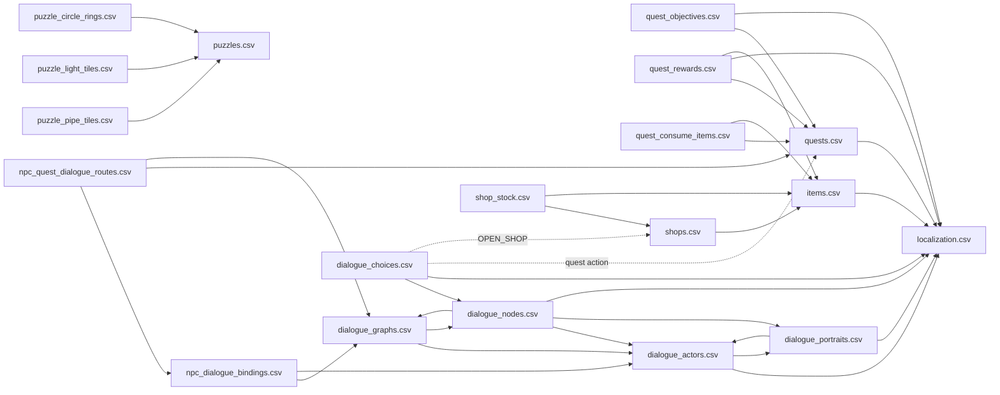
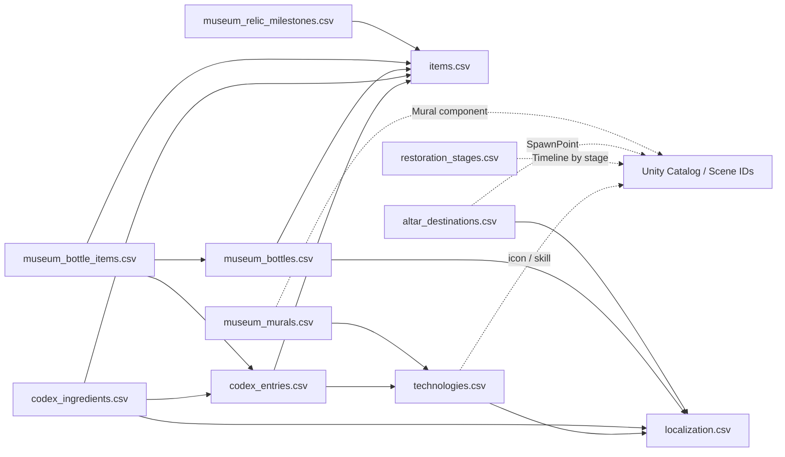

# CSV 교차 참조 지도

## 1. 목적

한 파일의 ID/키가 어느 파일에서 부모 또는 참조로 사용되는지 한눈에 확인한다. 화살표는 `참조하는 파일 → 참조 대상`이다.

점선은 `action_type`에 따라 조건부로 생기는 참조다.

## 2. 참조 필드 표

| 원본 파일.열 | 대상 파일.열 | 필수/조건 | 저장소 검증 |
|---|---|---|---:|
| items의 이름/설명 키 | localization.text_key | 필수 | 예 |
| actors.display_name_key | localization.text_key | 필수 | 예 |
| actors.default_portrait_id | portraits.(actor_id,portrait_id) | 선택 | 예 |
| portraits.actor_id | actors.actor_id | 필수 | 예 |
| portraits.display_name_key | localization.text_key | 선택 | 예 |
| graphs.start_node_id | nodes.(graph_id,node_id) | 필수 | 예 |
| graphs actor 3열 | actors.actor_id | 선택 | 예 |
| nodes.graph_id | graphs.graph_id | 필수 | 예 |
| nodes actor/portrait | actors/portraits | 선택 | 예 |
| nodes.body_text_key | localization.text_key | 필수 | 예 |
| nodes.next_node_id | nodes.(같은 graph_id,node_id) | 선택 | 예 |
| choices.(graph_id,node_id) | nodes 복합키 | 필수 | 예 |
| choices.choice_text_key | localization.text_key | 필수 | 예 |
| choices.next_node_id | 같은 그래프 node | 액션별 선택 | 예 |
| choices.action_id | quest/shop/flag | 액션별 | quest/shop은 예, flag는 형식만 |
| quest 상위 문구 | localization.text_key | 필수 | 예 |
| objectives.quest_id | quests.quest_id | 필수 | 예 |
| rewards.quest_id/item_id | quests/items | 조건별 | 예 |
| consume.quest_id/item_id | quests/items | 필수 | 예 |
| binding graph/actor | graphs/actors | 조건별 | 예 |
| routes npc/quest/graph | binding/quests/graphs | 필수 | 예 |
| 세 퍼즐 상세.puzzle_id | puzzles.puzzle_id | 필수, 종류 일치 | 예 |
| light.affected_tile_ids | 같은 퍼즐 tile_id | 필수 목록 | 예 |
| shops.currency_item_id | items.item_id | 필수 | 예 |
| stock.shop_id/item_id | shops/items | 필수 | 예 |

## 3. 자동 검증되지 않는 외부 연결

다음은 CSV 저장소만으로 완전히 확인할 수 없다.

- `quests.owner_npc_id`와 실제 NPC/장면 오브젝트
- NPC CSV의 `npc_id`와 상호작용 컴포넌트 ID
- `icon_id`, `sprite_id`, `background_id`와 에셋 카탈로그(일부 Editor 경고만 가능)
- 진행 플래그가 실제 게임플레이에서 설정되는지
- Circle `pattern_index`와 장면 프리팹 배열 상한
- 퍼즐의 수학적 해결 가능성
- 선택 CSV TextAsset의 `GameRoot` 연결

## 4. 권장 작성 순서

1. `localization.csv`
2. `items.csv`
3. 대화 배우 → 초상화 → 그래프 → 노드 → 선택지
4. 퀘스트 → 목표/보상/소비
5. NPC 바인딩 → 상태 라우트
6. 퍼즐 마스터 → 종류별 상세
7. 상점 → 재고 → `OPEN_SHOP` 대화

## 5. 관련 문서

- [ID 변경 영향 지도](ID_CHANGE_IMPACT_MAP.md)
- [전체 개요](../PHASE_00_FOUNDATION/CSV_SYSTEM_OVERVIEW.md)
- [CodeList](../PHASE_00_FOUNDATION/CODELIST_MASTER.md)
- [디자이너 워크플로](../PHASE_08_WORKFLOW_QA/DESIGNER_WORKFLOWS.md)

## 6. 도감·박물관 계획 참조 지도

아래 9종은 아직 런타임에 연결되지 않은 계획 계약이다. 점선은 Unity Catalog 또는 씬 ID 연결이다.

권장 작성 순서는 Localization·Items → Technologies·Stages → Codex·Ingredients → Bottles·BottleItems → Milestones → Altars·Murals이다. 자세한 상태 원본과 CSV 제외 대상은 [도감·박물관 가이드](../PHASE_09_CODEX_MUSEUM/README.md)에 있다.
